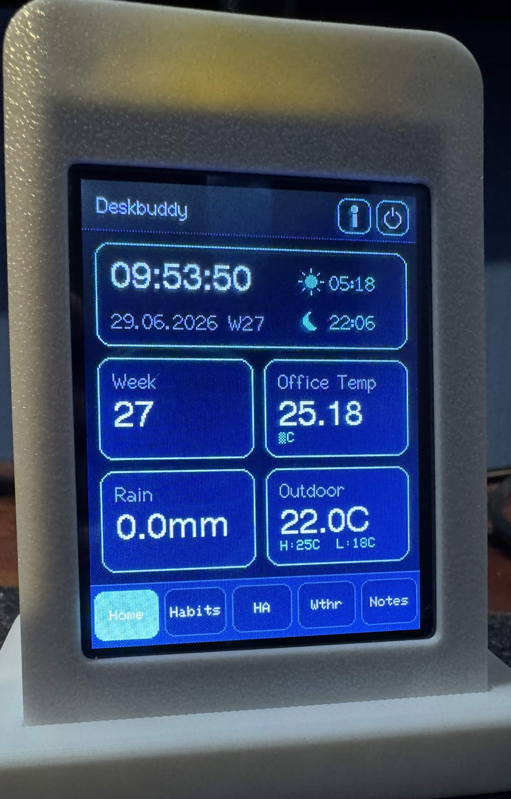
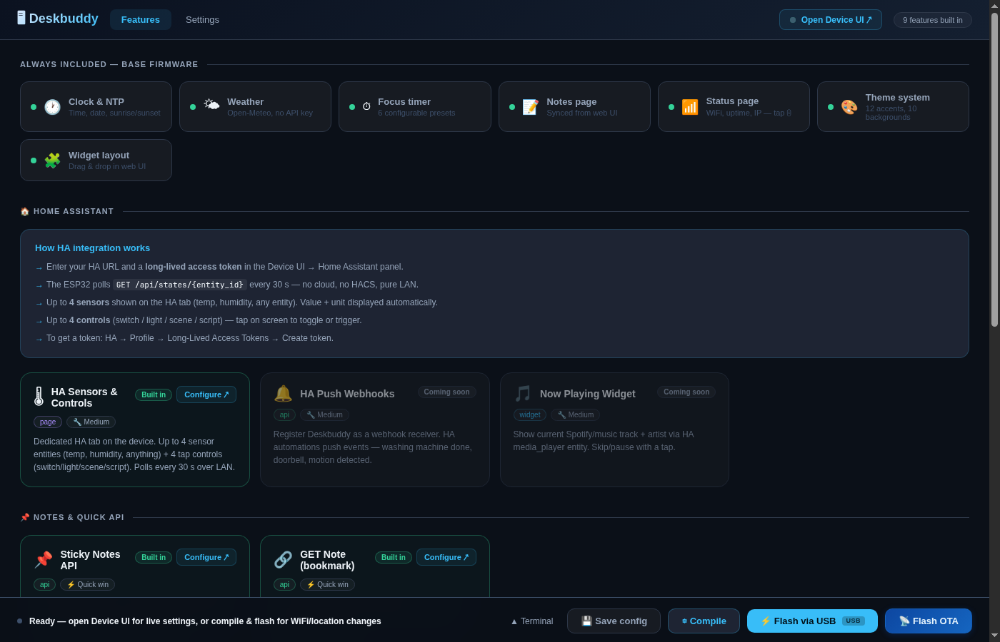
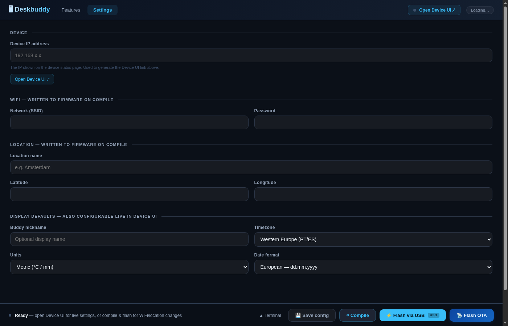
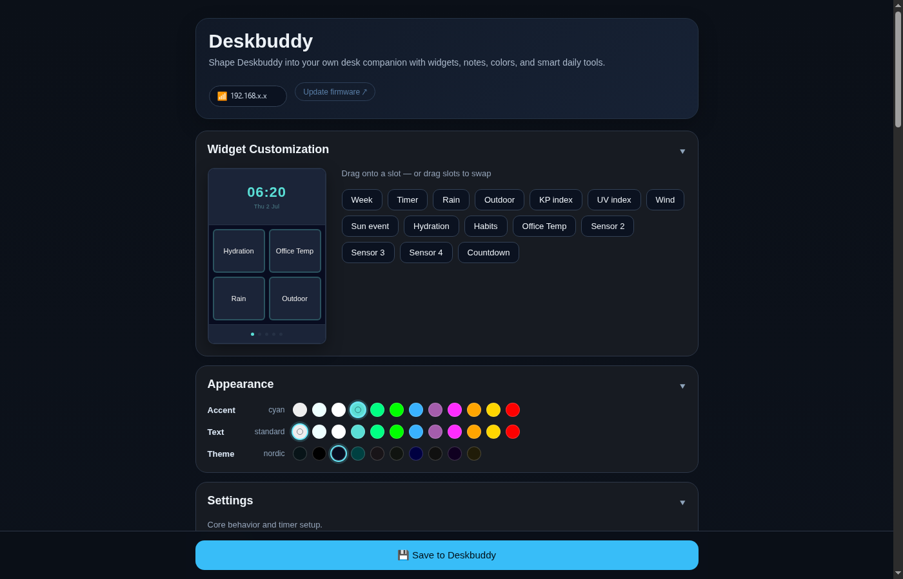

<div align="center">



# DeskBuddy

A compact ESP32 desk dashboard for the **ESP32-2432S028** ("Cheap Yellow Display").
Clock, weather, a class schedule, a daily quote, focus timer, Home Assistant
integration, and a browser-based configurator — all in one small touchscreen device.

[Features](#features) · [Getting started](#getting-started) · [Device web UI](#device-web-ui) · [Hardware](#hardware) · [Credits](#credits)

</div>

> **About this repository**
>
> This is a personal fork of [RolfKoenders/Deskbuddy](https://github.com/RolfKoenders/Deskbuddy),
> which is a substantial rewrite of [LextZip/Deskbuddy](https://github.com/LextZip/Deskbuddy).
>
> Changes in this fork relative to upstream: the `XPT2046_Touchscreen` library is
> vendored under `lib/` instead of being downloaded from GitHub at build time (so the
> project builds offline), and the firmware was reworked around a Chinese-language
> class schedule — the habit tracker is replaced by a **Schedule** page and its
> **Schedule** home widget, the notes page became a **Quote** page (每日一句), and the
> home clock card now shows weather advice. All credit for the original work belongs
> to the authors listed in [Credits](#credits). MIT licensed.

---

## Features

### Pages

| Page | What it shows |
|------|---------------|
| **Home** | Clock, week number, context clock, sunrise/sunset, weather advice (umbrella / heat / wind), and 4 configurable widgets |
| **Weather** | Temperature range, rain, wind, UV index, KP index, sun event |
| **Schedule** | Class timetable for the current weekday (Mon–Fri, up to 6 classes a day) with class name and room; paste a whole timetable to fill it in |
| **Home Assistant** | Live values from up to 4 HA sensor entities |
| **Quote** | Daily quote (每日一句): 25 built-in quotes rotating by date, overridable from the device web UI or by a note pushed over the REST API |
| **Status** | Device IP, WiFi signal, uptime, and display controls — opened from the **(i)** button in the top bar |

### Home widgets

Choose any 4 of these to show on your home screen:

| Widget | Description |
|--------|-------------|
| Week number | Current ISO week |
| Focus timer | Configurable countdown with presets |
| Outdoor temp | Current temperature + daily range |
| Rain | Precipitation forecast |
| Wind | Speed and compass direction |
| UV index | Low / Moderate / High / Very High / Extreme |
| KP index | Geomagnetic activity level |
| Sun event | Next sunrise or sunset, auto-switching |
| Hydration | Water intake counter, resets at midnight |
| Schedule | How many classes you have today |
| Countdown | Days until a configurable target date |
| HA Sensors 1–4 | Any Home Assistant sensor value with unit |

### Themes

**Backgrounds:** Slate · Deep · Nordic · Forest · Coffee · Soft · Midnight · Graphite · Garnet · Ochre

**Accents:** Standard · Cyan · Ice · White · Mint · Green · Blue · Purple · Pink · Orange · Amber · Red

All theme changes apply instantly via the browser UI, no reflashing needed.

### More

- **Context clock**: shows a second timezone on the clock card, great for remote teams
- **Class schedule**: Mon–Fri timetable, up to 6 classes a day, with bulk import (paste a whole timetable as `day time class room`)
- **Daily quote**: 25 built-in quotes rotating by date, or your own line set in the device web UI
- **Weather advice**: umbrella, heat, temperature-swing, wind and UV hints on the home clock card
- **Eye break reminders**: 20-20-20 rule overlay every N minutes, auto-dismisses after 20 seconds
- **Movement reminders**: "Time to move!" overlay every N minutes, tap to dismiss
- **Auto-dimming**: sleep modes with touch-to-wake, configurable dim and off intervals
- **NTP time sync**: timezone selection (UTC to UTC+12) with DST support for Europe, US, AU and more
- **Metric / imperial**: switch units and date format without reflashing
- **Nickname**: per-device label shown in the browser title bar
- **OTA updates**: flash new firmware over WiFi from the browser, no USB cable needed after the initial setup

---

## Getting started

See [SETUP_GUIDE.md](SETUP_GUIDE.md) for the full walkthrough. Quick version:

```bash
# 1. Clone
git clone https://github.com/tiantiankaixingg/Deskbuddy.git
cd Deskbuddy

# 2. Create your secrets file
cp include/secrets.h.example include/secrets.h
# Edit secrets.h — add WiFi credentials and your city's coordinates

# 3. Flash over USB
pio run --target upload

# 4. Open the device web UI
# Check serial monitor for the IP, then open it in a browser
```

Or use the **Python configurator** (`python configurator.py`) for a browser-based build, flash, and OTA tool. After the initial USB flash, future updates can be pushed wirelessly.

<div align="center">


</div>

---

## Flashing

| Method | When to use |
|--------|-------------|
| `pio run --target upload` (USB) | Initial setup, or after changing `secrets.h` |
| Configurator "Flash via USB" (USB) | Same as above, with a browser UI |
| Configurator "Flash OTA" (WiFi) | After initial setup, no USB cable needed |

You can also upload a `.bin` manually at `http://<device-ip>/update`.

---

## Device web UI

Open the device's IP address in any browser to change settings live. No reflash required:

- Widget layout (drag and drop which 4 widgets appear on the home screen)
- Class schedule: timetable editor with bulk import
- Theme: background, accent color, text color
- Context clock: second timezone and short label
- Location name, latitude, longitude
- Timezone, units, date format
- Focus timer presets
- Eye break and movement reminder intervals
- Buddy nickname
- Sleep / dim behavior
- Daily quote text (falls back to the built-in quote list)
- Home Assistant connection and sensor entity IDs

<div align="center">

</div>

---

## Sticky Notes API

Push a note to the device from anywhere on your network:

```bash
# Set a note
curl -X POST http://<device-ip>/api/note \
  -H "Content-Type: application/json" \
  -d '{"text": "Remember to water the plant"}'

# Clear the note
curl -X POST http://<device-ip>/api/note/clear

# Read the current note
curl http://<device-ip>/api/note
```

Works great with Home Assistant automations or a desktop shortcut.

---

## Home Assistant integration

In the device web UI, configure the HA base URL, bearer token, and up to 4 entity IDs. DeskBuddy polls those entities every 30 seconds over LAN and shows the current state and unit on dedicated home widgets and the HA page.

---

## Hardware

| Part | Link |
|------|------|
| ESP32-2432S028 (2.8" CYD) | [AliExpress](https://www.aliexpress.com/item/1005010525144441.html) |
| 3D printed case | [MakerWorld](https://makerworld.com/en/models/2725262-deskbuddy-your-personal-dashboard) |

---

## Credits

- Original project: [LextZip/Deskbuddy](https://github.com/LextZip/Deskbuddy) (MIT License)
- Substantial rewrite, current upstream: [RolfKoenders/Deskbuddy](https://github.com/RolfKoenders/Deskbuddy)
- `XPT2046_Touchscreen` library: [Paul Stoffregen](https://github.com/PaulStoffregen/XPT2046_Touchscreen)

Changes made in this fork relative to upstream:

- `XPT2046_Touchscreen` is vendored under `lib/` and the corresponding `lib_deps`
  entry was removed, so the project builds without fetching that library from GitHub.
- The habit tracker was replaced by a class schedule (Schedule page + Schedule home
  widget, with bulk timetable import), the notes page became the Quote page (每日一句),
  and the home clock card shows weather advice. The device UI text for those pages is
  in Chinese.

---

## License

MIT